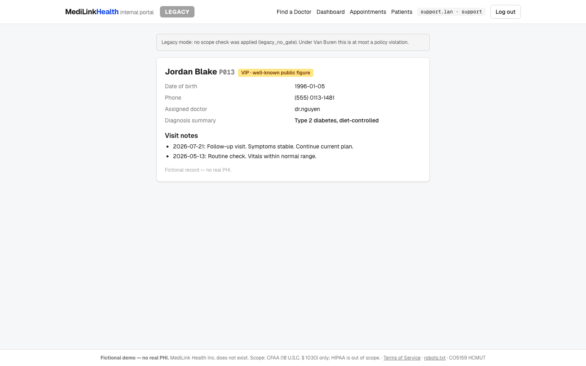
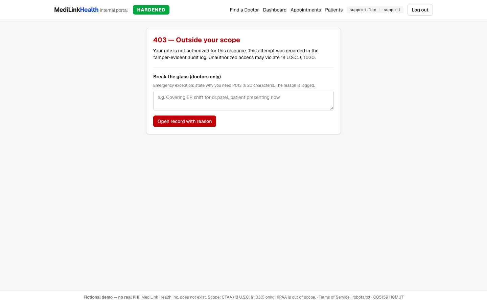
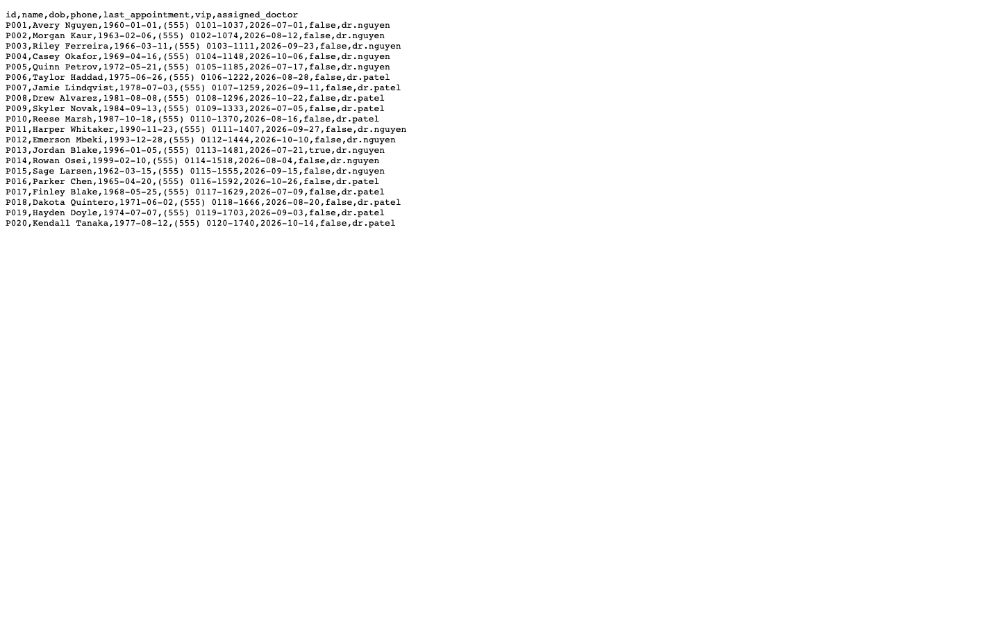
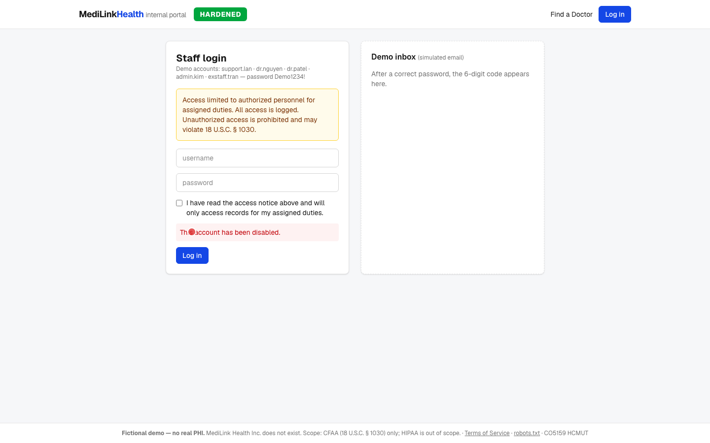
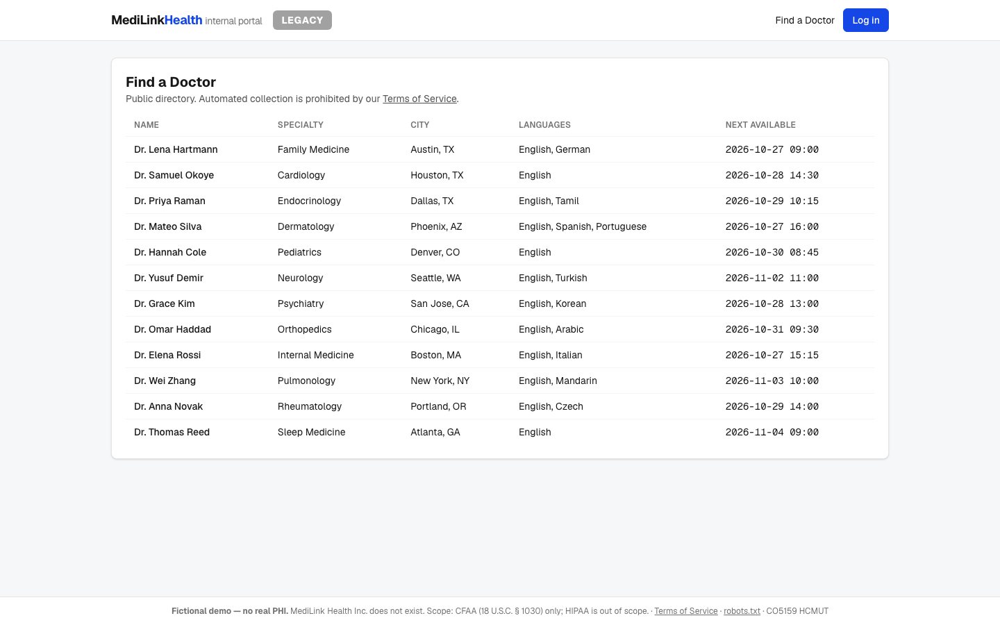
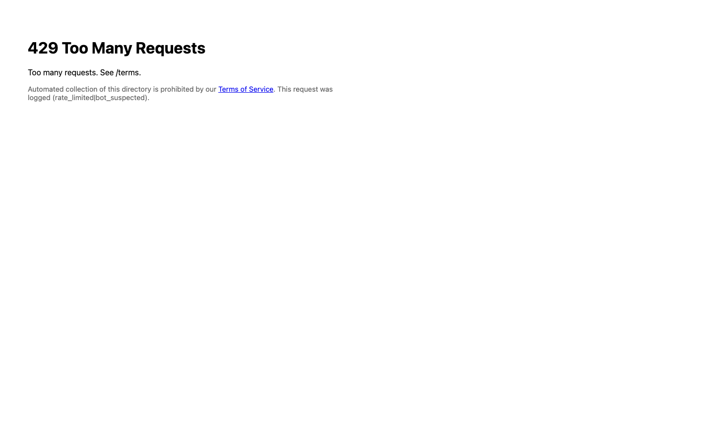
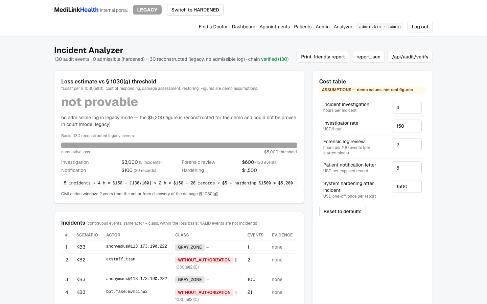
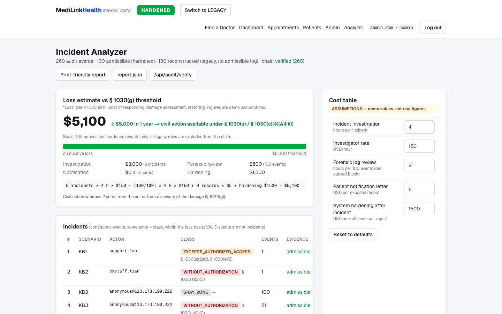
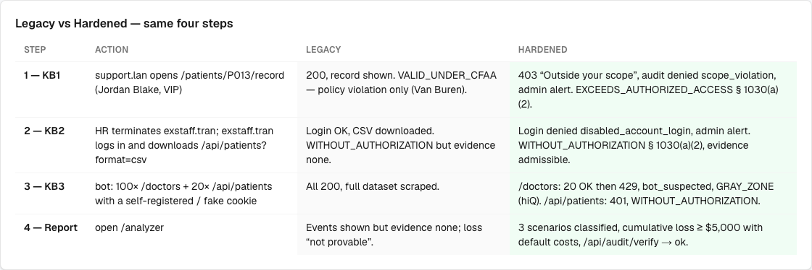

# MediLink CFAA demo — CO5159 (Law, Policy & Standards in Cybersecurity, HCMUT)

**Production:** https://medilink-cfaa-demo.vercel.app
**Repo:** https://github.com/ntranthi/medilink-cfaa-demo
**Video:** [`demo/medilink-cfaa-demo.mp4`](demo/medilink-cfaa-demo.mp4) — 3 min 27 s, 1080p H.264, recorded against production with `pnpm demo:record:prod`

> Fictional demo — no real PHI. MediLink Health Inc. does not exist. Scope is the Computer Fraud and Abuse Act,
> 18 U.S.C. § 1030, only. HIPAA is **out of scope** and nothing here claims HIPAA compliance.

## 1. Mục đích (Purpose)

MediLink Health là công ty telehealth hư cấu tại Mỹ. Cổng nội bộ cũ (**LEGACY**) để nhân viên xem bất kỳ hồ sơ nào,
nhân viên đã nghỉ việc vẫn đăng nhập được, API không có rào chắn và không có nhật ký nào dùng được làm chứng cứ.
Phiên bản **HARDENED** thiết kế lại cổng sao cho **mỗi truy cập trái phép trở thành một vi phạm CFAA có thể chứng minh**,
với chứng cứ đủ dùng cho vụ kiện dân sự theo § 1030(g).

Ba tình huống (KB) trong báo cáo:

| KB | Tình huống | Điều khoản |
|----|-----------|-----------|
| KB1 | Nhân viên hỗ trợ mở hồ sơ bệnh án của người nổi tiếng (P013 — Jordan Blake) | § 1030(a)(2)(C), § 1030(e)(6), *Van Buren v. United States* (2021) |
| KB2 | Nhân viên đã bị sa thải vẫn đăng nhập và tải toàn bộ danh sách bệnh nhân | § 1030(a)(2)(C); § 1030(a)(6) nếu bán dữ liệu; § 1030(a)(5) nếu gây hư hại |
| KB3 | Bot cào trang "Find a Doctor" công khai và gọi API nội bộ bằng tài khoản giả | § 1030(a)(2)(C) cho API; vùng xám cho trang công khai (*hiQ v. LinkedIn*, 9th Cir. 2022) |

## 2. Kiến trúc (Architecture)

```mermaid
flowchart LR
  B[Browser / scripts] -->|every request| P[proxy.ts<br/>/doctors only: rate limit + bot flags]
  B --> R[Next.js App Router pages<br/>+ Route Handlers]
  P --> G
  R --> G[lib/guard.ts<br/>ONE gate: allow / deny<br/>RBAC + scope, break-the-glass,<br/>session, partner key]
  G --> A[lib/audit.ts<br/>append-only, hash-chained<br/>sha256(prev_hash + row)]
  G --> DB[(Neon Postgres<br/>Drizzle ORM)]
  A --> DB
  DB --> AN[/analyzer<br/>lib/analyzer/classify.ts<br/>lib/analyzer/loss.ts]
  S[settings.security_mode<br/>legacy | hardened] --> G
```

* **One gate.** Every protected resource calls `guard()` in [`lib/guard.ts`](lib/guard.ts). It returns `allow | deny`
  and **always writes an audit row, in both modes**. Legacy rows carry `evidence_quality = none` — the old system kept
  no usable log; they are reconstructed for the demo and the Analyzer says so.
* **Van Buren.** The security-relevant code is commented with the legal reason: the gate must be *technical*
  (403, 401, 429), not a sentence in a policy.
* **Evidence.** `audit_log` is append-only: `hash = sha256(prev_hash + canonical JSON of the row)`; a DB trigger raises on
  `UPDATE`/`DELETE` (role separation is not available on the Neon free tier); `GET /api/audit/verify` re-walks the chain.

Stack: Next.js 16 (App Router, TypeScript, Server Actions + Route Handlers), Tailwind 4, Drizzle + `pg` on Neon
(Vercel Marketplace), own cookie session (bcrypt + HMAC-signed cookie), Postgres-backed sliding-window rate limit,
Playwright + ffmpeg-static for the video, `node --test` for unit tests. Package manager pnpm, Node 20+.

## 3. Cách chạy local (Run locally)

```bash
pnpm install
cp .env.example .env.local          # or: vercel env pull .env.local
pnpm db:push                        # create tables
pnpm db:seed                        # fictional data, mode = legacy (pnpm db:reset does the same)
pnpm dev                            # http://localhost:3000
```

Other scripts:

```bash
pnpm test             # unit tests: 6 classification rules, loss threshold, tamper detection
pnpm lint
pnpm scenario         # reset → run steps 1–4 in legacy, then in hardened; asserts the expected outcomes
pnpm bot              # just the KB3 scraper against BASE_URL
pnpm demo:record      # Playwright recording → demo/medilink-cfaa-demo.mp4 + demo/screenshots/*.png
pnpm demo:record:prod # same against BASE_URL from .env.production.local
```

## 4. Cách deploy Vercel (Deploy)

1. Import the GitHub repo in Vercel (Git integration; every push to `main` deploys).
2. Marketplace → Neon → connect to the project (sets `DATABASE_URL`), or
   `vercel integration add neon --plan free_v3 -m region=sin1 -m auth=false`.
3. Set `SESSION_SECRET` and `DEMO_ADMIN_RESET_TOKEN` (`vercel env add …`).
4. One-off: `vercel env pull .env.local && pnpm db:push && pnpm db:seed`.
5. `vercel.json` pins functions to `sin1` next to the database.
6. For the production run: create `.env.production.local` with `BASE_URL=https://…` and the same
   `DEMO_ADMIN_RESET_TOKEN`, then `pnpm scenario:prod` and `pnpm demo:record:prod`.

## 5. Tài khoản demo (Demo accounts)

Password for all: `Demo1234!`

| username | role | notes |
|----------|------|-------|
| `support.lan` | support | scope: appointments only |
| `dr.nguyen` | doctor | assigned patients P001–P005 (and P011–P015) |
| `dr.patel` | doctor | assigned patients P006–P010 (and P016–P020) |
| `admin.kim` | admin | toggles security mode, sees Admin + Analyzer |
| `exstaff.tran` | support | HR record: terminated 2026-09-01. Legacy: still active. Hardened: disabled on termination. Knows `support.lan`'s password (shared-password variant of KB2). |

Mode toggle: header button (admin) or `POST /api/demo/mode {"mode":"hardened"}` with
`Authorization: Bearer $DEMO_ADMIN_RESET_TOKEN`. Reset: Admin → "Reset demo data" or `POST /api/demo/reset`.

## 6. Bốn bước demo (The 4 steps)

| Step | Action | LEGACY | HARDENED |
|------|--------|--------|----------|
| 1 — KB1 | `support.lan` opens `/patients/P013/record` | 200, record shown. Analyzer: **VALID_UNDER_CFAA**, "policy violation only — Van Buren" | 403 "Outside your scope", audit `denied scope_violation`, admin alert. Analyzer: **EXCEEDS_AUTHORIZED_ACCESS** § 1030(a)(2) |
| 2 — KB2 | HR terminates `exstaff.tran`; `exstaff.tran` logs in, downloads `/api/patients?format=csv` | login OK, CSV 200. Analyzer: **WITHOUT_AUTHORIZATION** but evidence *none* | login denied `disabled_account_login`, red admin alert. Analyzer: **WITHOUT_AUTHORIZATION** § 1030(a)(2), evidence *admissible* |
| 3 — KB3 | `scripts/bot.ts`: 100× `/doctors` + 20× `/api/patients` with a self-registered / fake cookie | all 200, full dataset scraped | `/doctors`: 20 OK then 429, `bot_suspected`, **GRAY_ZONE** (hiQ). `/api/patients`: 401, **WITHOUT_AUTHORIZATION** |
| 4 — Report | open `/analyzer` | events shown, evidence none, loss "not provable" | incidents classified, cumulative loss ≥ $5,000 with the default cost table, `/api/audit/verify` → ok |

Screenshots (from `pnpm demo:record`):

| | LEGACY | HARDENED |
|-|--------|----------|
| 1 |  |  |
| 2 |  |  |
| 3 |  |  |
| 4 |  |  |

Comparison card: 

## 7. Luật áp dụng cho từng bước (Law per step)

Classification is a pure function, [`lib/analyzer/classify.ts`](lib/analyzer/classify.ts), with unit tests for every rule.

| Rule (in order) | Class | Citation | Note |
|-----------------|-------|----------|------|
| Actor had no valid authorization at the time of access (disabled/terminated account, self-registered fake account, unauthenticated or forged-cookie API call) | `WITHOUT_AUTHORIZATION` | § 1030(a)(2)(C); add § 1030(a)(6) if data later sold/transferred; § 1030(a)(5) if damage | KB2, KB3-API |
| Valid user denied by a **technical** gate (RBAC/scope 403, break-glass refused) | `EXCEEDS_AUTHORIZED_ACCESS` | § 1030(a)(2)(C), § 1030(e)(6) | "Van Buren: gate was technically closed" — KB1 hardened |
| Valid user, access allowed by the system even if the purpose was improper | `VALID_UNDER_CFAA` | — | "policy violation only — not CFAA after Van Buren (2021)" — KB1 legacy |
| Break-the-glass allowed with a logged reason (≥ 20 chars) | `VALID_UNDER_CFAA` | — | "authorized by exception, reason logged" |
| Public page scraping, rate-limited or not | `GRAY_ZONE` | — | "hiQ v. LinkedIn (9th Cir. 2022): serious question whether CFAA applies; rely on ToS / cease-and-desist" — KB3 public |
| Authenticated API scraping with a fake account | `WITHOUT_AUTHORIZATION` | § 1030(a)(2)(C) | KB3 legacy |

Each event in the Analyzer shows the English label, a short Vietnamese explanation, the citation, and the evidence
quality: **admissible** (hardened, hash-chained log) or **none** (legacy, reconstructed for the demo).

Civil action: § 1030(g) — loss ≥ $5,000 in any 1-year period (§ 1030(c)(4)(A)(i)(I)); 2 years from the act or from
discovery of the damage.

## 8. Giả định về chi phí tổn thất (Loss assumptions)

**ASSUMPTIONS — demo values, not real figures.** Editable in the Analyzer UI; defaults in
[`lib/analyzer/costs.ts`](lib/analyzer/costs.ts). "Loss" follows § 1030(e)(11) (cost of responding, damage assessment,
restoring the system).

| Item | Default | Unit |
|------|---------|------|
| Incident investigation | 4 | hours per incident |
| Investigator rate | 150 | USD/hour |
| Forensic log review | 2 | hours per 100 events (per started block) |
| Patient notification letter | 5 | USD per exposed record |
| System hardening after incident | 1,500 | USD one-off, once per report |

Model ([`lib/analyzer/loss.ts`](lib/analyzer/loss.ts)): an *incident* is a contiguous run of events by the same actor
with the same class (VALID events are not incidents). Only **admissible** rows form the basis of a provable total;
when there are none (legacy), the total is shown as *"not provable"* with the reconstructed figure. "Exposed" records
are patient rows actually returned to an actor without (sufficient) authorization — denied requests expose nothing.

Hardened demo run with defaults (as recorded): 5 incidents × 4 h × $150 + ⌈130/100⌉ × 2 h × $150 + 0 × $5 + $1,500 = **$5,100 ≥ $5,000**; `/api/audit/verify` → `{"ok":true,"length":260}`.

## 9. Giới hạn của demo (Limitations)

* **Policy-only misuse is not covered.** After *Van Buren* (2021), an insider who is allowed through the gate but acts
  for a bad purpose does not violate the CFAA. The legacy KB1 access is exactly that: a policy violation, not a crime.
* **Public scraping is a gray zone.** *hiQ v. LinkedIn* (9th Cir. 2022) leaves serious doubt that the CFAA reaches
  public pages. The hardened system rate-limits and flags bots, but the legal remedies are the ToS and a
  cease-and-desist letter.
* **CFAA is US law only.** Nothing here speaks to Vietnamese law or to HIPAA.
* **Demo simplifications**: MFA codes appear in an on-page "demo inbox"; the device check is a cookie, not a real
  fingerprint; the HR webhook is unauthenticated apart from the demo token; the rate limiter uses a global advisory
  lock and a plain table; the audit log's append-only guarantee is a trigger plus code, not a separate DB role.
* **Loss figures are assumptions**, labelled as such wherever they appear.

## 10. Ghi chú dùng AI (AI usage note)

This app was scaffolded and implemented with an AI coding agent (Claude Code, model Claude Fable 5.1) working from a
written specification. The agent: created the repo and Vercel project, provisioned Neon through the Marketplace,
wrote the schema, seed, guard, auth, audit chain, pages, Analyzer, scripts, Playwright recording, unit tests and this
README; ran the scenario locally and against production; recorded the video. The specification, the legal framing
(KB1–KB3, the classification rules, the cost table) and the review of the result are the author's.

License: MIT.
